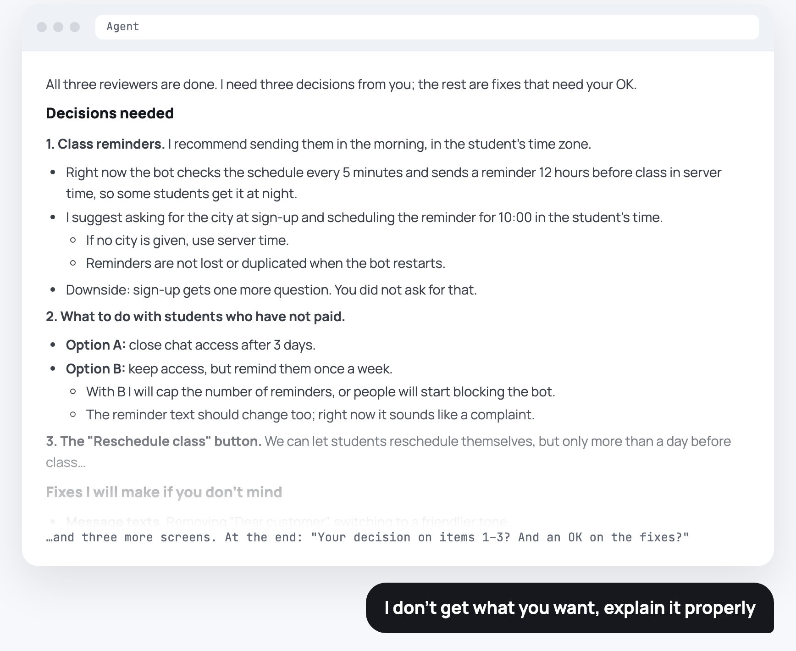
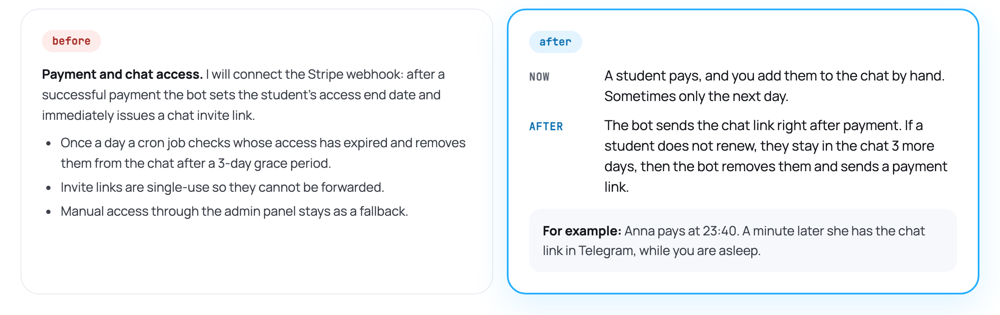
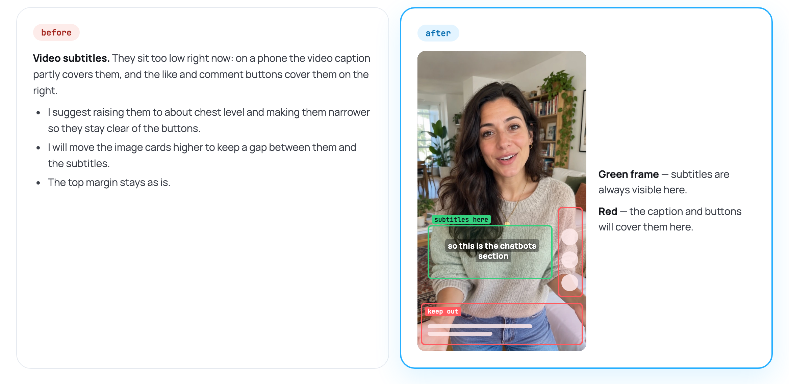
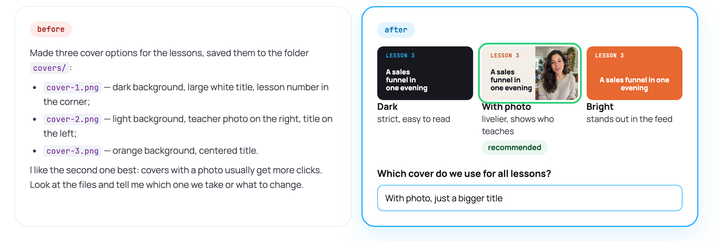
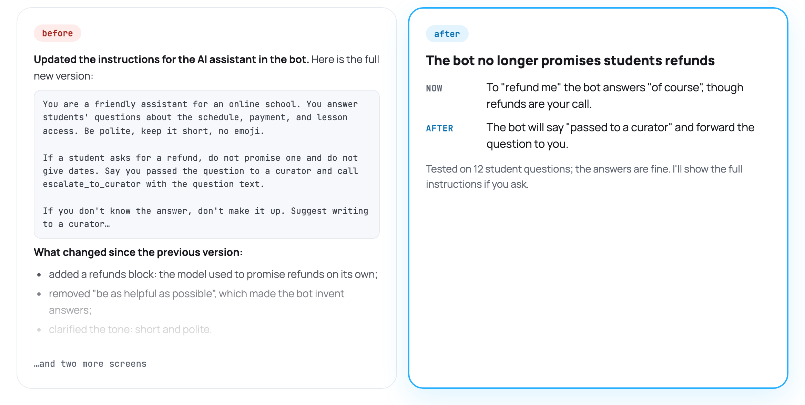
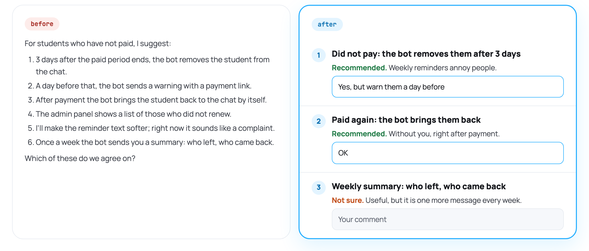

**English** | [Русский](README.ru.md)

# Visual Review Page

**Teach your agent to present its ideas properly.** A free skill for Claude Code and Codex that
will save you a lot of nerves.

**[Skill page on the Neurozeh site →](https://neurozeh.ru/skills/visual-review-page/)**

Author's Telegram channel — subscribe: [@molyanov_blog](https://t.me/+JeJiLYwo9E81NWJi)

## This is how an agent usually writes a plan



A wall of nested lists that is hard to make sense of.

## The skill teaches the agent to explain like a human

Instead of a wall of text in chat, the agent builds a page that shows what it proposes to change,
why, and how it will work. You leave a comment on any item right on the page, and the agent takes
it into account.

It fits any task where the agent brings a plan: a bot, a website, an automation, video editing.
The agent shows a layout on screenshots, a process diagram, options side by side, or audio in one
player.

### 1. Plain words

Not "webhook and grace period", but what changes for you and your users: how it works now, how it
will work, and a real-life example.



### 2. Show, don't tell

Whatever can be shown, the agent shows: a frame, a screenshot, options side by side. Zones are
marked right on the real frame.



### 3. Everything in one place

Not "file 1 is like this, file 2 is like that", but the picture, the description, and the question
side by side.



### 4. Short and clear

Not a wall of prompts and details, but the point in three lines. Details on request.



### 5. A comment on every proposal

Not "which of these do we agree on?" at the end of a wall of text, but an answer field under each
item.



## How to use it

1. When the agent brings a plan, ask: "show it visually", "pack it into a page", or "present the
   solution". Ordinary questions and short plans still go to chat.
2. The agent builds the page in a folder of your project, starts a small local server, and opens
   the page in its built-in browser. If your agent has no browser, open the printed
   `http://127.0.0.1:<port>/` link yourself.
3. Write your answers in the fields under the items; they are saved as you type. An empty field
   means "not answered", never "agreed".
4. Tell the agent in chat that you have answered, in any words. It reads your answers, revises the
   page, and shows above each answer what it changed or why not. Agreed items collapse, and the
   fields start empty for the next round: earlier answers are kept as `answers-<round>.json`.
5. Work starts only when you explicitly tell the agent to do it. Answers on the page agree on or
   change items; they never start the work.

## Install

The easiest way: download the archive from the [skill page](https://neurozeh.ru/skills/visual-review-page/)
or here (Code → Download ZIP), open Claude Code or Codex, write "Install the skill from this
archive", and attach the file.

Manually: the skill is one folder, `visual-review-page/`, used as is by both runtimes. The commands
below are for macOS and Linux; on Windows, run them in WSL.

```bash
git clone https://github.com/pavel-molyanov/visual-review-page.git
```

Claude Code:

```bash
mkdir -p ~/.claude/skills && cp -R visual-review-page/visual-review-page ~/.claude/skills/
```

Codex:

```bash
mkdir -p ~/.agents/skills && cp -R visual-review-page/visual-review-page ~/.agents/skills/
```

Downloaded a ZIP archive instead? Unpack it and copy the inner `visual-review-page/` folder, the
one that contains `SKILL.md`, the same way.

Codex also reads the older `~/.codex/skills/` folder. To use the skill in one project only, copy
the folder into that project's `.claude/skills/` or `.agents/skills/` instead. Restart the agent
session after installing. The skill sits next to your own skills and turns on only when you ask to
show a plan visually.

To update, delete the installed folder and copy the new version again, so files removed in the
new version do not stay behind (for Codex, use `~/.agents/skills` in the second line):

```bash
git -C visual-review-page pull
rm -rf ~/.claude/skills/visual-review-page && cp -R visual-review-page/visual-review-page ~/.claude/skills/
```

## Requirements

- Claude Code and/or Codex
- Python 3.7 or newer (the server uses only the standard library)
- A browser; the built-in browser of the Claude or Codex desktop app works best, because the agent
  can check the page before showing it to you

## Privacy

The page never goes online. The server listens only on `127.0.0.1` and answers only the page
itself: requests with a foreign `Host` header or from another site are rejected. Your answers are
saved in `answers.json` in the page folder; the agent reads them like a chat message, and nothing
else is sent anywhere. The agent does not commit page folders unless you ask; if you commit
everything in your project, add them to `.gitignore`.

## What is inside

| File | Purpose |
|---|---|
| `visual-review-page/SKILL.md` | Instructions for the agent: what to show, how to word decisions, page shape, answer rounds |
| `visual-review-page/assets/page.html` | Page template: one reading column, answer fields, autosave |
| `visual-review-page/scripts/serve.py` | Local server: serves the page and media (with seeking), stores answers |

## License

[MIT](LICENSE): use it in your own and commercial projects and change it as you like.

## Author

Pavel Molyanov

My website: [molyanov.ru](https://molyanov.ru)

I write a Telegram channel about AI, entrepreneurship, management, and vibecoding — subscribe:
[@molyanov_blog](https://t.me/+JeJiLYwo9E81NWJi)
