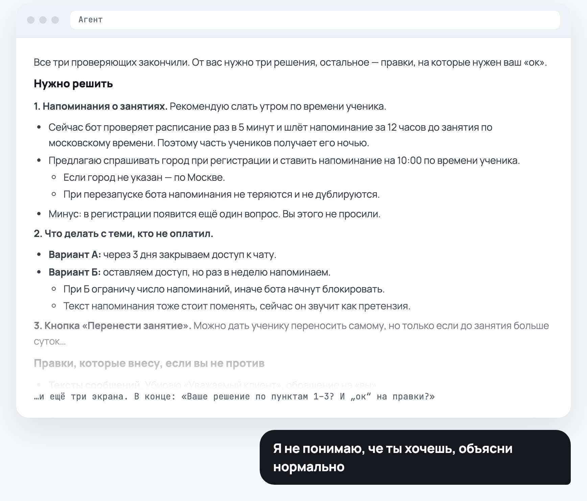
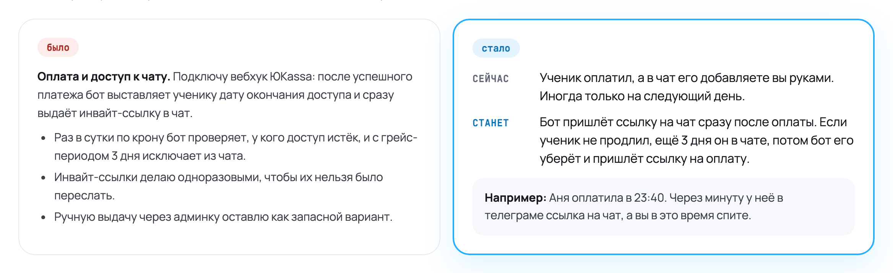
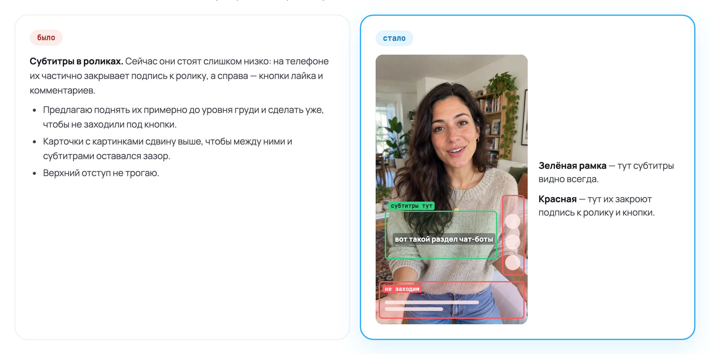
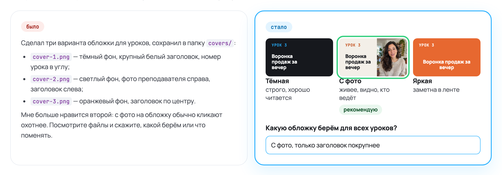
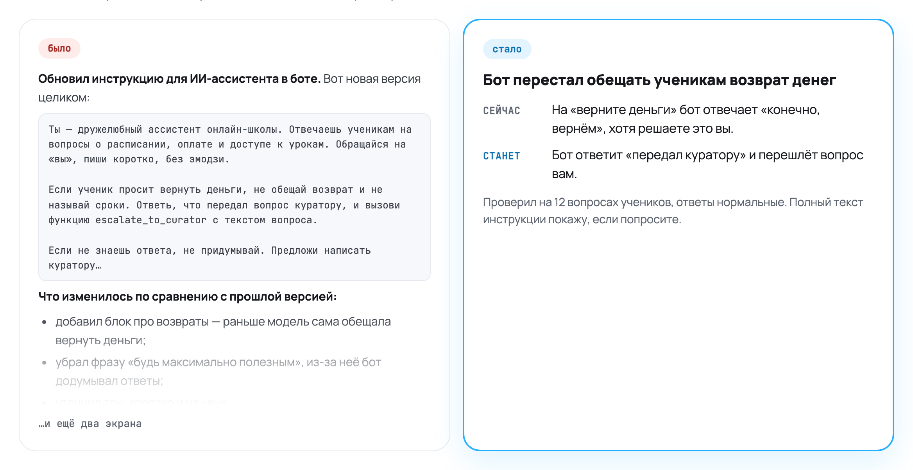
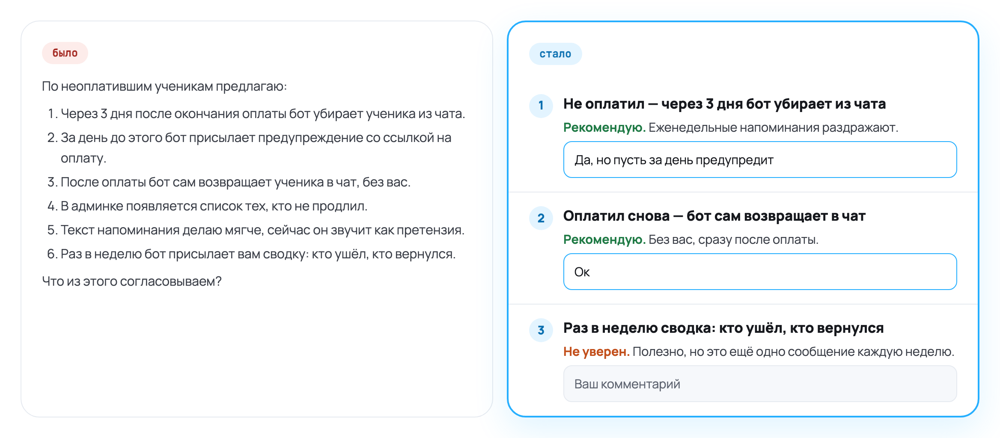

[English](README.md) | **Русский**

# Visual Review Page

**Учим агента нормально презентовать свои идеи.** Бесплатный скилл для Claude Code и Codex,
который сэкономит вам кучу нервных клеток.

**[Страница скилла на сайте Нейроцеха →](https://neurozeh.ru/skills/visual-review-page/)**

Телеграм автора — подписывайтесь: [@molyanov_blog](https://t.me/+JeJiLYwo9E81NWJi)

## Обычно агент пишет план как-то так



В этих бесконечных списках фиг разберёшься.

## Скилл учит агента объяснять по-человечески

Вместо полотна текста в чате агент собирает страницу, где наглядно показывает, что и зачем
предлагает поменять и как это будет устроено. К любому пункту вы оставляете комментарий прямо на
странице, и агент его учтёт.

Подходит для любых задач, где агент приносит план: бот, сайт, автоматизация, монтаж роликов.
Агент покажет вёрстку на скриншотах, схему процесса, варианты рядом или звук в одном плеере.

### 1. Простым языком

Не «вебхук и грейс-период», а что изменится для вас и ваших пользователей: как сейчас, как будет
и живой пример.



### 2. Показывать, а не рассказывать

Что можно показать, агент показывает: кадр, скриншот, варианты рядом. Зоны размечены прямо на
настоящем кадре.



### 3. Всё в одном месте

Не «файл 1 — такой, файл 2 — такой», а картинка, описание и вопрос рядом.



### 4. Коротко и понятно

Не полотно с промптами и подробностями, а главное в трёх строках. Детали — если попросите.



### 5. Комментарий к каждому предложению

Не «что из этого согласовываем?» в конце простыни, а поле для ответа под каждым пунктом.



## Как пользоваться

1. Когда агент принесёт план, попросите: «покажи наглядно», «упакуй в страницу» или «презентуй
   решение». Обычные вопросы и короткие планы агент по-прежнему пишет в чат.
2. Агент соберёт страницу в папке вашего проекта, запустит маленький локальный сервер и откроет
   её во встроенном браузере. Если браузера у агента нет, откройте ссылку
   `http://127.0.0.1:<порт>/` из его ответа сами.
3. Пишите ответы в поля под пунктами — они сохраняются по ходу набора. Пустое поле значит
   «не ответил», а не «согласен».
4. Напишите агенту в чате любыми словами, что ответили. Он прочитает ответы, поправит страницу и
   над каждым ответом покажет, что изменил или почему нет. Согласованные пункты сворачиваются, а
   поля для следующего раунда снова пустые: прошлые ответы сохраняются в `answers-<раунд>.json`.
5. Работа начинается, только когда вы прямо скажете агенту приступать. Ответы на странице
   согласуют или меняют пункты, но не запускают работу.

## Установка

Проще всего: скачайте архив на [странице скилла](https://neurozeh.ru/skills/visual-review-page/)
или здесь (Code → Download ZIP), откройте Claude Code или Codex, напишите «Установи скилл из
этого архива» и приложите файл.

Вручную: скилл — это одна папка `visual-review-page/`, она подходит обоим агентам без изменений.
Команды ниже — для macOS и Linux; на Windows запускайте их в WSL.

```bash
git clone https://github.com/pavel-molyanov/visual-review-page.git
```

Claude Code:

```bash
mkdir -p ~/.claude/skills && cp -R visual-review-page/visual-review-page ~/.claude/skills/
```

Codex:

```bash
mkdir -p ~/.agents/skills && cp -R visual-review-page/visual-review-page ~/.agents/skills/
```

Скачали ZIP-архив? Распакуйте его и так же скопируйте внутреннюю папку `visual-review-page/` —
ту, где лежит `SKILL.md`.

Codex читает и старую папку `~/.codex/skills/`. Чтобы скилл работал только в одном проекте,
скопируйте папку в `.claude/skills/` или `.agents/skills/` этого проекта. После установки
перезапустите сессию агента. Скилл ставится рядом с вашими и включается, только когда вы просите
показать план наглядно.

Чтобы обновиться, удалите установленную папку и скопируйте новую версию заново, иначе файлы,
удалённые в новой версии, останутся (для Codex во второй строке — `~/.agents/skills`):

```bash
git -C visual-review-page pull
rm -rf ~/.claude/skills/visual-review-page && cp -R visual-review-page/visual-review-page ~/.claude/skills/
```

## Что нужно

- Claude Code и/или Codex
- Python 3.7 или новее (сервер использует только стандартную библиотеку)
- Браузер; лучше всего встроенный браузер в десктопных приложениях Claude и Codex: агент сможет
  проверить страницу, прежде чем показать её вам

## Приватность

Страница не уходит в интернет. Сервер слушает только `127.0.0.1` и отвечает только самой
странице: запросы с чужим заголовком `Host` или с другого сайта отклоняются. Ответы сохраняются в
`answers.json` в папке страницы; агент читает их как обычное сообщение в чате, больше они никуда
не отправляются. Агент не коммитит папки страниц, если вы не попросите; если вы коммитите в
проекте всё подряд, добавьте их в `.gitignore`.

## Что внутри

| Файл | Зачем |
|---|---|
| `visual-review-page/SKILL.md` | Инструкции для агента: что показывать, как описывать решения, устройство страницы, раунды ответов |
| `visual-review-page/assets/page.html` | Шаблон страницы: одна колонка для чтения, поля ответов, автосохранение |
| `visual-review-page/scripts/serve.py` | Локальный сервер: отдаёт страницу и медиа (с перемоткой), сохраняет ответы |

## Лицензия

[MIT](LICENSE): можно использовать в своих и коммерческих проектах и менять под себя.

## Автор

Павел Молянов

Мой сайт: [molyanov.ru](https://molyanov.ru)

Веду Телеграм-канал про AI, предпринимательство, менеджмент и вайбкодинг — подписывайтесь:
[@molyanov_blog](https://t.me/+JeJiLYwo9E81NWJi)
